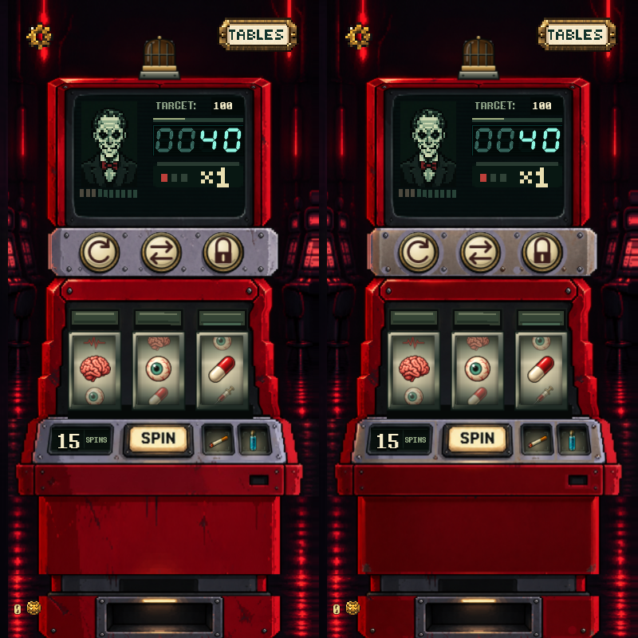
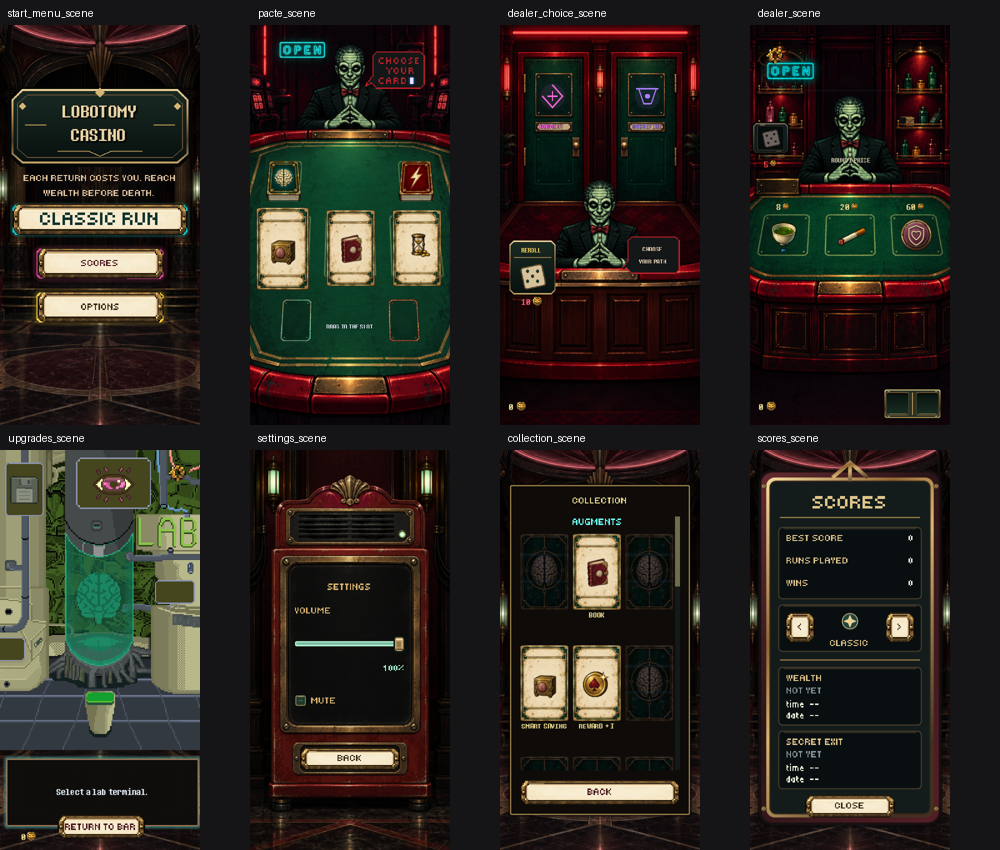

# Machine art-direction reference

The machine now has quieter enamel faces and warmer satin-steel rails. Its red
stepped silhouette, CRT, sockets, controls and reel composition remain the same.
This is a machine-only material pilot. Other families were inspected and ranked
below; they have not been repainted in this pass.

Open [the comparison viewer](review.html) for native framebuffer images and an
eight-second synchronized motion comparison. Left is before; right is after.

## What was inspected

The baseline is the **existing uncommitted working tree**, captured before this
pass, rather than an older Git revision. It already includes baked cabinet
registration, domed power caps, physical reel travel, heat effects, the lit score
readout and revised shelf wells. Those improvements are not attributed to this pass.

Ran the real machine with isolated stores, seed 170316, and captured 240 motion
frames at a fixed 30 fps: idle, a paid spin with sequential reel stops, x2 heat,
x3 heat and the loss warning. Reviewed the frame sequence, resting states and
targeting, plus the existing interactive machine review. Also rendered ten
scenes at four window sizes and inspected their source masters, vector hardware,
symbol exports, card art and item exports.

The 160×320 area is a layout safe area. Comparisons are actual 400×800,
540×960, 450×1000 and 800×1000 framebuffer captures, with fractional scaling
and overscan. They were not enlarged from a 160×320 screenshot. The viewer uses
one CSS pixel per captured pixel; browser zoom and OS display scaling still apply.

## Specific machine findings and changes

| Finding in the baseline | Treatment in this pass | Gameplay-size judgment |
| --- | --- | --- |
| The pale lilac rails have widespread pits and flecks, reading more like stone or damaged plastic than steel. | Transfer quiet warm steel planes onto the power rail and shelf, retaining the original fasteners, bores and well lips. | The plates read as related structural parts; brass caps belong against them more convincingly. |
| The large red panel has long isolated streaks and scattered chips with little connection to construction or handling. | Give the front a deeper continuous enamel plane; concentrate visible damage at the kick corners and lower return. | The panel reads as a service door. Stickers can supply its changing run identity without competing with random marks. |
| The red fascia has broad flat colour and busy surface wear; seams can disappear into it. | Use a restrained top reflection and darker lower return inside the existing panel boundaries. | The shelf sits on a folded metal fascia with depth. The original service recess remains clear. |
| Smooth brass/enamel controls and rough grey plates suggest different rendering treatments. | Match the surrounding steel's warmth and broad lighting to the existing caps; retain their dark seating shadows. | Better material cohesion without repainting the glyphs or weakening ready/selected/spent states. |
| Cabinet side steps and CRT edges retain coarse, sometimes nearly uniform red outlines. | Preserve these identifying edges during the material pilot. | Still a visible limitation, especially at large tablet size. A later edge pass should vary highlight length by plane orientation, not add more outlines. |
| x3 heat fills lamp cores with white and turns the upper red header orange. | Keep the existing light maps, ramps and particles. | Heat escalation and warning recovery remain readable. The brightest x3 header still loses enamel detail; a follow-up should narrow the core mask while preserving the ignition and surge timing. |

The generated study was **not** substituted wholesale. It shifted small contours,
changed some screws and introduced unwanted transparency. Only selected interior
material planes were transferred. Everything outside the explicit transfer mask,
including the background, CRT and reel backing, is byte-identical to the baseline.

## Acceptance judgment

| Criterion | Assessment |
| --- | --- |
| Readability | Improved separation of structural metal, enamel and inset controls. Existing score, counter, glyph and symbol contrast stays readable. |
| Character | The oxblood cabinet and worn kick corners preserve the sinister appliance identity. Large quiet panels are intentional space for augment stickers. |
| Cohesion | The rail and shelf now share a warmer steel family, fitting the brass and ivory controls. |
| Believable construction | More continuous panel planes and localized edge wear; original bolts, socket throats, folded returns and glass wells remain authoritative. |
| Restraint | No extra ornament, labels, scratch noise or baked gameplay. The remaining coarse outer edges and x3 clipping are explicitly deferred. |

This is a useful reference for steel, enamel and wear placement. It is not yet a
complete reference for every animation family or for overdrive lighting.

## Source measurements and preserved contracts

The registered input and runtime output are both **1280×2560**, eight source
pixels per layout unit. The study is 887×1774 and is sampled only inside the
material masks. The original alpha is copied without alteration.

| Feature | Measured source geometry / retained runtime geometry |
| --- | --- |
| Reel holes | Half-open pixel rectangles `(264,1352)–(432,1624)`, `(520,1352)–(688,1624)`, `(776,1352)–(944,1624)`. All alpha samples retained. |
| Power centres | Layout `(46,126.5)`, `(77,126.5)`, `(108,126.5)` → source `(368,1012)`, `(616,1012)`, `(864,1012)`. Bores protected from transfer. |
| Cabinet origin | Canvas `(4,0)`, including shake/heartbeat recovery. |
| SPIN touch box | Canvas `(57,213,46,28)`. Texture treatment does not move the button or change its input. |
| Remaining-spin counter | Canvas `(28,213,14,16)`. Existing live text retained. |
| Stash | Original wells and existing 16×18 touch slots / 12×14 icon footprints retained. |
| Safe area | 160×320 layout units, centered by `Presentation`; no important art or hitbox moved into overscan. |

Reels, lamps, jackpot beacon, power caps, SPIN states, item icons, stickers, CRT
content and heat/particle layers remain separate. Payout, target-drain, power
restore, dealer, warning and compulsory-spin sequencing are unchanged.

## Wider asset audit — next work in order

| Priority / family and source | Specific weakness at gameplay size | Recommended local treatment |
| --- | --- | --- |
| 1. Lab — `godot/scenes/upgrades_scene.gd`, `godot/assets/images/upgrade_scene/` | Flat olive fills, uniform pale outlines and visibly coarse diagonal clusters clash with the painted rooms. The central tank's glass, contents and metal share weak value separation. | Repaint static shell planes around existing terminal masks. Give metal a clear top face/return, reserve green transmission for the tank, and keep blink screens, purchase states and terminal input separate. |
| 2. Pacte/dealer felt and cabinetry — `pacte_polished/pacte_scene_painted.png`, `dealer_shop_polished/pre_dealer_shop_painted.png` | Random dark felt mottling competes with the offer areas. Gold recess outlines, wear and live card edges stack into several equally strong contours. Lower red padding is often brighter than the choices. | Quiet the felt in live card footprints, reduce secondary trim contrast, and concentrate wear at the player's table edge. Preserve the table's depth; keep cards, drop frames, prompts and dealer layers independent. |
| 3. Symbols/items — `symbols/premium/`, `items/generated/` | Syringe shafts and small bottle necks lose separation when reduced. Tea, potion and serum become similarly small vessels in stash/badge views. Colourful internal shading cannot compensate for a weak outline. | Judge symbols at the real 40px central-reel height, stash items around 30×35px, and badges around 20px at a 400×800 display. Simplify internal divisions and strengthen distinctive mass/negative space; use one broad highlight rather than several thin ones. Retain IDs and shared lookup paths. |
| 4. Cards — `cards/painted/`, `pacte_scene/augment_card.png`, `pacte_scene/power_card.png` | Distressed parchment borders and gold corners dominate small emblems; thin brain/coin/filigree details merge. Book's 1254px export and legacy 22×27 source underline the mixed source scale. More pixels alone will not improve the silhouette. | Reduce paper spots near the emblem, unify the frame's edge width and highlight direction, and tune each emblem at its 24-unit footprint. Keep Pattern Recognition/How to Cheat animation frames and all card interaction geometry. |
| 5. Route lobby — `dealer_choice_polished/choice_scene_painted.png` | Bright red architectural strips compete with the small live route symbols; the flat route plaques have less material depth than the doors. | Lower secondary neon contrast and seat live plaques with a matching contact shadow and highlight. Preserve each door's shape, live price and hover/open frames. |
| 6. Shared controls/settings/scores — `ui/premium/`, `settings_polished/`, `scores_polished/` | Small chips, corner marks and bright borders accumulate around tiny labels. The repeated ivory button material is cohesive, but its brightness can outrank the room's focal object. | Reuse the machine's warm ivory/brass values and dark seating gap; simplify subordinate corner marks. Inspect normal/hover/pressed/disabled/focus together, including French labels. |
| 7. Authored animation families — neuron death, payout/endings, animated card emblems | Their coarse pixel clusters remain a different edge language from the painted shells. Static replacement would erase useful state and timing. | Review full frame sequences and alpha extents before repainting. Retain cumulative death overlays, payout ownership and authored frame order. |

Paths in the table are relative to `godot/assets/images/` unless fully qualified.
These are observed art-direction findings, not claims that every asset in a
family needs replacement. The Lab is the biggest cohesion gap; the existing
dealer identity, reel-symbol colour families and ivory control language are
worth retaining.

## Rebuild and verification

`py tools/refine_machine_materials.py` rebuilds the runtime PNG from the archived
baseline and study. It asserts unchanged alpha and unchanged pixels outside the
mask. Both archives are tooling inputs; exported builds load only
`godot/assets/images/machine_polished/cabinet_material_pass.png`, with mipmaps.
See [the exact generation prompt and provenance](provenance.md).

For comparisons, create an output directory and run
`godot --path godot -s res://test/debug_art_direction.gd --fixed-fps 30` with
`ART_REVIEW_DIR` set. `ART_CABINET` can override the texture for the baseline;
the archived baseline needs copying into a temporary `res://` path and importing
if rerendering it. The delivered before images were captured before integration.
All review stores are sandboxed; use an isolated `APPDATA` directory as well.

Validation on the current working tree:

- Godot 4.7 import completed; new runtime texture uses lossless import and mipmaps.
- Deterministic motion review passed: 240 frames and four actual display sizes.
- Display review passed: ten scenes at four sizes, including safe-area and input checks.
- Scene smoke passed: **111 checks, no unexpected engine errors**, outside the filesystem sandbox.
- Existing interactive machine art review passed: mouse/focus SPIN, Shift targeting, locks, dealer, payout, item wells, Learning and Tunnel Vision.
- An isolated copy of `6a77c67` plus only this PR's integration passed its **106-check** scene smoke suite, including the baked-aperture contract. The extra working-tree checks and machine-feel work are not required by the material asset.

The initial sandboxed smoke run had 111 green checks but failed the engine-error
gate because Windows certificate-store access was blocked. It was rerun outside
the sandbox successfully; no error allowlist was weakened. No rules, economy,
save data or gameplay were changed, so rules parity was not required.

## Branch and working-tree preservation

Started on `fix-mobile-startup-black-screen` at `6a77c67`, with extensive existing
uncommitted changes and open PR #242. The owner explicitly authorized treating
that branch as superseded for this task while leaving its PR untouched. Work is
on `tweak-machine-art-direction`; nothing is merged.

The original baked image remains at its existing path and is also archived as
`tools/art_sources/machine-direction-baseline.png`. The material asset has a new
name. Existing machine work, addon changes and other asset edits remain in the
working tree. Only the material asset, supporting review files and the minimal
cabinet integration contract are included in this pass's commit.
