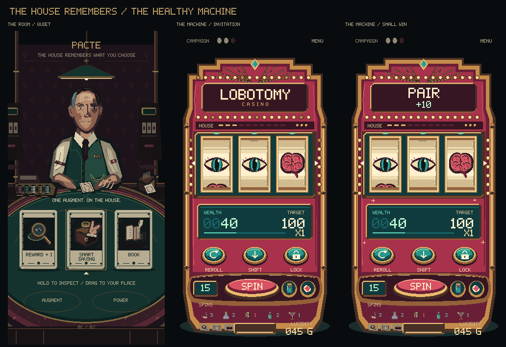

# Lobotomy Casino — The House Remembers

[Open the offline visual review](review.html). Revision 04 makes the existing multiplier a whole-machine output state: **x1 ready, x2 running hot, x3 maximum output**. The healthy reward focus remains; end-of-run decay is separate. The common source grid remains 640×1280. [Multiplier heat revision](REVISION_04.md).



This phase-one direction includes a concise [art bible](ART_BIBLE.md), original [dealer concept](../../godot/assets/art_direction/house_remembers/dealer_states.png), 27 scene/overlay compositions, [21 individual card faces](../../godot/assets/art_direction/house_remembers/card_sheet.png), ten timing/state studies with atlases, source and gameplay-size views, a phone contact sheet, and a [phase-two integration contract](INTEGRATION.md). [Output ladder](../../godot/assets/art_direction/house_remembers/multiplier_heat_benchmark.png) shows all three tiers; [heat animation](../../godot/assets/art_direction/house_remembers/animation/multiplier_heat.gif) shows their movement. [Healthy reward benchmark](../../godot/assets/art_direction/house_remembers/machine_reward_benchmark.png) shows ready, win and settle. [Scene inventory](SCENES.md) distinguishes active flow from compatibility files and records current routing discrepancies. [Tool discovery](TOOLS.md) records verified capabilities and sources, including UltraCode.

The current live game and existing uncommitted work are preserved. No mechanics, scene controllers, saves or asset bindings were changed. New review assets are under `godot/assets/art_direction/house_remembers`; editable recipes are under `tools/house_identity`.

```powershell
python tools/generate_house_identity.py
python tools/verify_house_identity.py
```

The HTML review opens locally and has no external dependencies. Interactive controls provide dealer-state selection, card inspection, source-image inspection, phone/layout-size selection and motion pause. Browser execution is pending because no browser surface was enabled during this session; the supplied JavaScript is syntax-checked. Visual QA is recorded separately and does not pretend to be runtime Godot validation.

The current workspace also passed Godot editor import and scene smoke (**111 checks, no unexpected engine errors**). [Art validation](validation.json) and [Godot validation with scope and existing diagnostics](godot_validation.json) record the practical limits of those checks.
