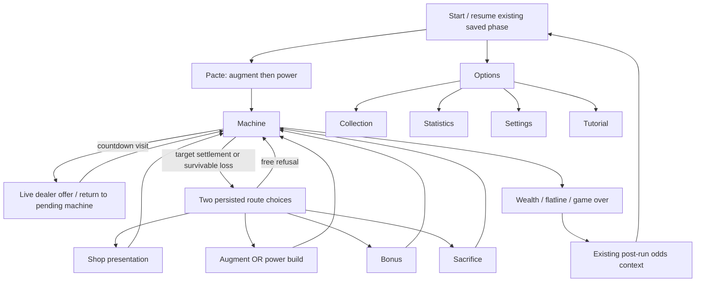

# Scene inventory and visual staging

Inventory follows the current navigation code, not filenames alone. `start_menu_scene.gd`, `dealer_choice_scene.gd`, `scene_nav.gd`, `options_overlay.gd`, run resume handling, Pacte and route destination controllers were inspected. The design includes the Lab requested in the brief, although a current entry path to `upgrades_scene` was not found in those active controllers. It is a retained feature design, not an invented additional room on the run route.

## Player-facing presentations

| Review master | Purpose / what the player does | Composition and information order | Feeling and distinctive detail |
|---|---|---|---|
| 01 Start | Start or resume; pre-launch suit selection; records/options | Gaming-floor aisle between roulette and slots; house lettering over a waiting croupier; primary seat action, suit row, secondary actions | A casino after midnight, still accepting customers. The roulette wheels establish gaming activity before the title. Resume substitutes its existing action/state; the suit selector stays locked during an active run. |
| 02–03 Pacte | Choose one of three augments, then one of three powers | Player seated at a horseshoe baize table; croupier behind, shoe to his right, discard to his left; three lit cards, inspection, then two placement arcs | Complimentary service, binding consequence. Different card backs signal the phase. No extra confirmation cost, deck or cancel rule. |
| 04–05 Machine | Read revealed reels, score/target, resources; spin and manipulate symbols | Bowed oxblood cabinet with tall central drums; one account window below the reels; separate approach rail, power strip, spin shelf/stash and duration rail; inspectable build tabs at the foot | The machine feels alive through a tensioned grille, breathing side bellows and an exhale reflection. Advanced strain stays inside the body. No dealer portrait occupies the interface. |
| 06 Dealer visit | Inspect/take an offer or refuse; keep taking distinct from using | Croupier returns to the same working table; two ordinary item positions and a campaign chip position; live price/effect inspection and take/refuse; stash at player edge | He knows what you need. Expanded offers use a third ordinary position without hiding the campaign chip. Reroll/service affordances must retain their existing actions in integration. |
| 07 Routes | Choose one of exactly two deterministic routes, reroll or refuse | Two actual gaming bays beyond the pit rail, each with its own apparatus; route name, fee, selected consequence, live balance; reshuffle and free continue below | The casino offers two places to spend the next interval. These are gaming bays rather than hotel doors. Five route types share this staging. |
| 08–09 Single-deck build | Inspect and buy one augment OR one power | One deck on the dealer-side riser and three offered fronts across the table, inspection and price before committing | A focused specialist table. Preserve post-loss free tier-0 pools, diamond restrictions and any replacement picker. |
| 10 Shop | Buy run investments and stash consumables | A service docket laid on baize beside actual drum components and bottles; names, live costs, selection explanation, purchase/leave | A casino's mechanic doing paid work. Base sample prices shown are Brain Feed 20, Pair Guard 28, Stasis 22 from `ShopItems`; markups remain live. |
| 11 Bonus | Claim the existing Fortune Wheel result once | Full upright mechanical wheel with betting wedges, brass pointer, weighted feet and claim action | A show of generosity on house equipment. Artwork wedges are composition only: do not infer odds or outcome selection from painted wedge area. |
| 12 Sacrifice | Trade one eligible resource or refuse | Assay balance temporarily set on the gaming table; offered resource on one pan, five chips on the other; eligibility, trade count, exact consequence above actions | Polite accounting becomes personal. Resource selector must include every existing eligible resource, not just the illustrated Book example. |
| 13 Lab | Inspect/purchase permanent progression with wallet credits | Back-of-house disconnected machine test jig; coil terminals, calibration trace, tools and memory cell; selected upgrade and tier controls on the near bench | You glimpse how the house maintains its customers. It remains a casino workshop, not a second setting. |
| 14 Odds | Stage a symbol level, return the token with minus, commit/cancel | Large marked gaming register with symbols, levels, minus/plus; token at player's edge; selected row and DONE/CANCEL | A permanent entry in a house book. The mock shows Eye staged, zero tokens, every plus closed, only its minus available. |
| 15 Collection | Scroll stable catalogue; inspect owned/locked cards | Casino card folio spread across the table; augments then powers as stable sections, physical fronts/backs, inspection | A carefully preserved history. Locked fronts/names/effects remain secret; the gallery's art review is not the runtime collection visibility policy. |
| 16 Statistics | Read existing saved history | Mechanical tally printer feeding fan-fold stock; tracked values in a descending receipt | The house remembers exact amounts. Numbers in art are illustrative, not new statistics. |
| 17 Tutorial | Follow existing guided steps | An opaque paper instruction slip points into the actual game composition and yields to required interaction | A courtesy lesson delivered at the table. Remap all current tutorial targets to the new coordinates; do not replace the tutorial with the sample Pacte step. |
| 18 Settings | Volume and mute; preserve any current setting | House audio desk with perforated speaker grille, Bakelite knobs, clear muted state and back | Private adjustment of the room's sound, away from gambling actions. |
| 19 Options | Records, settings, collection, tutorial, language, return to menu, close | A compact overlay version of the house control desk; six legible rows, distinct close action | Courtesy without a new location. Underlying scene returns through the existing navigation stack. |
| 20 Wealth | Bank or take the existing continuation | Vey behind the table; organized payout chips occupy the betting space; 5000 and the two existing choices | You can close your account, but his welcome does not change. Banking waits for the choice. |
| 21 Flatline | Read retained Lucidity, continue the existing survivable/fatal handoff | A settlement slip pushed across the baize, a small retained stack, campaign loss indication | The house calls this a settlement. The receipt uses the actual existing keep calculation. |
| 22 Game Over | Return from the fatal campaign ending | Same table and employee chair, now empty; one facedown card in the player's place | Absence completes the loss. No new comeback option. |
| 23 Card unlock | Acknowledge one persisted unlock; collection or continue | One enlarged front above the table with live name/effect and two actions | A place was being kept for you. Process the existing persisted queue one card at a time. |
| 24 Inspection | Read a full owned card name/effect and return | Enlarged same-source card plus live localized description beneath | The illustration survives enlargement; effect copy remains readable. Mandatory Reward symbol picking must still be mandatory. |
| 25 Rescue | Understand the pending loss and available corrective actions | Warning occupies account/result area; reels, powers, stash and SPIN remain exposed | The machine waits for your decision. No control-darkening effect or timer added. |

## Existing transition map

This is the intended user-facing flow from the brief. The current active route selector and resume code send Shop to **`dealer_scene.tscn`**. The older `route_scene` sends it to `route_shop_scene`. Therefore 10 Shop is a **visual specification of the run-investment service**, not a claim that current dealer code already binds that inventory. Resolve the existing discrepancy during phase-two presentation integration without changing economy or route save state.

`route_scene`, `route_shop_scene`, legacy pre-run consumable shops and the old route-dealer shell do not receive extra standalone designs merely because files exist. Their meaningful retained presentation uses the same Shop/dealer components; explicit resume compatibility paths must still load. `shop_scene` and `upgrades_scene` remain existing meta implementations, not new route types. The Lab design is included because the user expressly requested it.

## Scene-specific motion and transitions

Cards cross the table from the shoe, decelerate on felt and stop without bouncing. Pacte changes decks only after the existing saved selection completes. Route selection tracks the chosen bay with a short pan under the existing cover/handoff; no extra decision is introduced. Shop purchase gets a latch click and a physical docket mark. Bonus's pointer motion consumes a pre-resolved result. A sacrifice balance tips only after confirmation. Lab contacts energize to the owned tier. The odds token moves once on staging and returns on minus. Collection pages slide while keeping stable catalogue order. Printer receipts settle for statistics/endings. Settings knobs rotate immediately without a scene fade. Every transition uses the existing navigation completion signal, never an artwork frame as gameplay truth.
